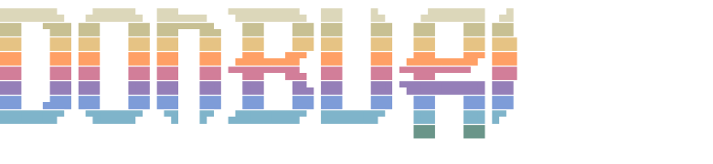
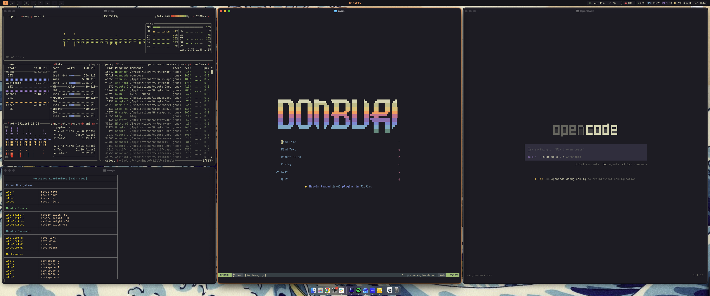

<p align="center">
  <br>
  
</p>
<p align="center">A unified macOS dotfiles configuration</p>

---

## Introduction

Donburi is a unified dotfiles repository for macOS that brings together terminal, multiplexer, editor, and shell configurations into a cohesive development environment. Rather than treating each tool as an island, donburi creates a seamless workflow where navigation feels natural across all applications.

The philosophy centers on three principles: **consistent hjkl-based navigation** across all tools, a **unified Kanagawa color scheme** for visual harmony, and a **herdr-centric workflow** where one terminal window holds every workspace, tab, and AI agent. Whether you're navigating Neovim splits or herdr panes, the muscle memory transfers.

Installation is **non-destructive**—existing configurations are automatically backed up before any changes are made. You can install everything at once or pick individual components to adopt incrementally.

<p align="center">
  
  <br>
  <sub>Screenshot taken on a 34" ultrawide monitor. This is my personal, opinionated configuration — your mileage may vary.</sub>
</p>

## Features

- **Unified hjkl-based navigation** across multiplexer, editor, and terminal
- **Non-destructive installation** with automatic backups of existing configs
- **Modular installation** — install all components or pick what you need
- **Consistent Kanagawa color scheme** across all applications
- **Workspace-centric workflow** via [herdr](https://herdr.dev), an agent-aware terminal multiplexer
- **Quick config aliases** for editing any configuration file

## Requirements

- **macOS 15+** (Sequoia)
- **Git** — for cloning the repository
- **Homebrew** — package manager for macOS (optional with `--no-brew` flag)

All other dependencies are installed automatically during setup (see below).

**Note for corporate users**: See [ENTERPRISE_SETUP.md](ENTERPRISE_SETUP.md) for installation in restricted environments.

## Quick Start

**One-liner installation:**

```bash
curl -fsSL https://raw.githubusercontent.com/jonataseduardo/donburi/main/install.sh | bash
```

This installs donburi to `~/.donburi` and adds the `donburi` command to your PATH.

**Or clone manually:**

```bash
git clone https://github.com/jonataseduardo/donburi.git ~/.donburi
~/.donburi/donburi setup
```

After installation:

```bash
donburi brew-check      # Check Homebrew status
donburi brew apps       # Install applications (nvim, ghostty, btop, etc.)
donburi setup           # Install all configurations
```

For environments without Homebrew:

```bash
donburi setup --no-brew # Setup configs without brew dependencies
```

## Components

| Component      | Description                               | Config Location                                              |
| -------------- | ----------------------------------------- | ------------------------------------------------------------ |
| **Neovim**     | Text editor with LSP, completions, AI     | `~/.config/nvim`                                             |
| **Ghostty**    | Modern GPU-accelerated terminal           | `~/Library/Application Support/com.mitchellh.ghostty/config` |
| **herdr**      | Agent-aware terminal multiplexer          | `~/.config/herdr`                                            |
| **zsh**        | Shell configuration with Oh My Zsh        | `~/.zshrc`                                                   |
| **btop**       | Resource monitor with Kanagawa theme      | `~/.config/btop`                                             |

### What Setup Installs Automatically

Each `donburi setup` component installs its own dependencies via Homebrew, git, and curl scripts:

| Component      | Auto-installed Dependencies                                                                                        |
| -------------- | ------------------------------------------------------------------------------------------------------------------ |
| **Neovim**     | ripgrep, gcc, make, [lazy.nvim](https://github.com/folke/lazy.nvim) plugin manager                                 |
| **Ghostty**    | JetBrains Mono Nerd Font                                                                                           |
| **herdr**      | herdr (via the official `curl` installer into `~/.local/bin`), jq (used by the `Ctrl+hjkl` navigation script) |
| **zsh**        | [Oh My Zsh](https://ohmyz.sh/), [Powerlevel10k](https://github.com/romkatv/powerlevel10k), fzf, lsd, gnu-sed, gawk |
| **btop**       | None (no external dependencies)                                                                                    |
| **Language Runtimes** | [Rust](https://www.rust-lang.org/) (via rustup), [uv](https://astral.sh/uv) (Python), [bun](https://bun.sh) (JavaScript) |

Neovim LSP servers and plugins auto-install on first launch via Mason and lazy.nvim.

### Custom Neovim Plugins

In addition to kickstart-modular.nvim's core plugins, donburi includes these custom plugins:

| Plugin | Purpose |
|--------|---------|
| **ChatGPT** | AI-powered code completion and generation |
| **dadbod** | Database UI and SQL query execution |
| **diffview** | Enhanced Git diff visualization |
| **fugitive** | Git integration and operations |
| **ghostty** | Ghostty terminal integration |
| **Kanagawa** | Unified color scheme with purple split dividers |
| **lualine** | Kanagawa vibrant statusline with flame separators |
| **markdown-preview** | Live Markdown preview |
| **python-debugger** | Python debugging support |
| **render-markdown** | Enhanced Markdown rendering |
| **smart-splits** | Seamless split navigation across Neovim and herdr panes |
| **toggleterm** | Integrated terminal multiplexer |

All plugins auto-install on first Neovim launch. View/manage with `:Lazy`.

### herdr Workspace Search

**Ctrl+f** opens a unified `fzf` popup containing open workspaces,
recent folders from `zoxide` (when installed), and folders under **`$HOME`**,
including projects such as `~/ia/charge-code-curator`. Type to search names and
full paths; the list shows the full path
and whether an item is a workspace or folder. **Open workspaces always come
first**, including while filtering. Within each group, the most frequently
selected items come first, with most recently selected items breaking ties.
Selection counts appear as `[N uses]` and persist across Herdr restarts; a
workspace inherits the usage history of its folder. Items without selection
history retain their discovery order, including the order returned by `zoxide`.

| Key inside search | Action |
|-------------------|--------|
| **Enter** on a Workspace | Switch to that open workspace |
| **Enter** on a Folder | Create and focus a workspace in that existing folder |
| **Ctrl+r** | Refresh the cached folder list |
| **Esc** | Cancel |

For example, type part of a project folder's name, select the matching Folder
row, and press Enter to create its workspace immediately. Opening a folder
already used by a workspace's pane focuses that workspace instead of creating
a duplicate. New workspaces use the folder name as their label.

The native workspace/pane navigator is available with **Ctrl+b, then w**;
**Ctrl+b, then n** still switches to the next tab.

The popup uses `herdr/scripts/workspaces.py` and requires `python3` and `fzf`.
To restrict or change search roots, set `HERDR_PROJECT_ROOTS` in the popup command in
`herdr/config.toml`, for example:

```toml
command = "HERDR_PROJECT_ROOTS=\"$HOME/c:$HOME/ia:$HOME/Projects\" python3 ~/.config/herdr/scripts/workspaces.py"
```

Discovery includes folders up to three levels below each root and the top 100
recent folders. Hidden directories, macOS `Library`, and dependency/build folders
(`node_modules`, `vendor`, `target`, `__pycache__`) are skipped to keep search fast.
The scanner examines directory entries only and does not descend into folders
at the depth limit. Folder discovery is cached for five minutes; reopening the
picker uses that cache, while open workspaces are fetched live every time. Use
**Ctrl+r** to discover newly created folders immediately. Removed folders may
remain listed until refresh; selecting one reports that it no longer exists.

Cache: `${XDG_CACHE_HOME:-~/.cache}/herdr/workspace-picker/folders.json`.
Usage history: `${XDG_STATE_HOME:-~/.local/state}/herdr/workspace-picker/usage.json`.

After changing bindings, use **Ctrl+b, then
Shift+r** to reload both client and server configuration.

### herdr Agent Coordinator

**Ctrl+a** toggles your rolling assistant: a long-lived Claude Code session on a
**fast model (Haiku by default)** that follows every agent in herdr, tells you
which ones need you, takes you to them, and relays your messages to the
stronger agents doing the work. It runs as the herdr agent **`coordinator`** in
its own **`◉ coordinator`** workspace, started in your ops repo **`~/ia/ds-hq`**
(GitHub `jcesar/ds-hq`), so it picks up that repo's `CLAUDE.md`, skills and team
config, and keeps watching while you work elsewhere.

**Modal, like vim.** The coordinator workspace has two panes:

| Pane | Mode | What it is |
|------|------|------------|
| `history` (top, 70%) | Normal | Neovim, read-only and live: the conversation as Markdown. All vim motions, `/` search, yank; `]]` / `[[` jump between turns, `zc`/`zo`/`zM`/`zR` fold turns and sessions; at the end it follows new output (like `less +F`) |
| `prompt` (bottom) | Insert | Claude Code: type to the coordinator |

**You always know you are in it.** The coordinator's color is herdr's orange
accent (`#FF9E64`, surimiOrange), and no worker uses it:

- **Sidebar and window title.** The workspace is labelled `◉ coordinator`, drawn
  in orange by a `[ui.sidebar.spaces]` rule, and kept first in the list
  (`coordinator.sh` moves it there on each **Ctrl+a**). herdr's default window
  title then reads `<host>: ◉ coordinator`. Keeping it first shifts the other
  workspaces' **Ctrl+b, then Shift+1..9** numbers down by one.
- **History pane.** One shade darker than Kanagawa's background (sumiInk0), with
  a banner across the top: an orange `◉ COORDINATOR` block, the agent count with
  blocked and working agents in herdr's state colors, and the `i` / **Ctrl+a**
  hints. It refreshes every 3 seconds from `agent_watch.py --counts`.
- **Prompt pane.** Claude's status line repeats the banner, with the model
  (`herdr/scripts/coordinator_status.py`, set as `statusLine` in
  `herdr/coordinator-settings.json`, refreshed every 5 seconds). Your usual
  status line is unchanged in other sessions.
- **Agents panel.** The coordinator's own row has the orange `◉` marker.

| Key | Action |
|-----|--------|
| **Ctrl+a** | Switch to the coordinator; from the coordinator, back to where you were. The first press creates the workspace, starts Claude and its feed |
| **i** `a` `o` **Enter** (in `history`) | Jump to the prompt (insert mode) |
| **Ctrl+k** (in `prompt`) / **Ctrl+j** (in `history`) | Move between the panes (smart-splits) |
| **Ctrl+b, then Shift+h** | The focused agent's conversation in the same Neovim view, as a popup (`:q` closes) |
| **Ctrl+b, then o** | Jump to the agent behind the latest toast (works without the coordinator) |

Ask it things such as:

- "what needs me?" (lists blocked agents and what each one is asking)
- "take me to the violet one" or "take me to the invoice parser" (focuses that agent; **Ctrl+a** brings you back)
- "tell w9:p2 to rebase on main" (sends your message with `herdr agent prompt`)
- "start a reviewer on ~/c/donburi" (creates a workspace and a worker agent)

**Agent markers.** Every agent gets a marker: a small shape in a Kanagawa
color, picked to sit next to herdr's own state glyphs (`× ◐ ✓ ○`) without
reusing their colors:

| Marker | Color | Kanagawa |
|--------|-------|----------|
| ● | blue `#7FB4CA` | springBlue |
| ◆ | violet `#957FB8` | oniViolet |
| ■ | indigo `#7E9CD8` | crystalBlue |
| ▲ | pink `#D27E99` | sakuraPink |
| ★ | white `#DCD7BA` | fujiWhite |
| ▼ | gold `#C0A36E` | boatYellow2 |
| ✚ | cyan `#A3D4D5` | lightBlue |
| ✦ | rose `#E46876` | waveRed |
| ◉ | orange `#FF9E64` | surimiOrange, the coordinator only |

The marker stays with the agent's terminal. It shows in color in the herdr
sidebar (`$mark`, colored by sidebar rules) and in the Neovim history pane, and
as a plain shape on the agent's pane border
(`show_agent_labels_on_pane_borders`) and in Claude's own pane, which herdr and
Claude cannot color; that is why each color has its own shape. With more than
eight agents markers repeat; `◉` is never reused. The feed script sets them as herdr pane metadata
(source `donburi-marks`) while the coordinator runs; pass `--no-marks` to
`agent_watch.py` to turn this off. The palette lives in three places that a test
keeps in step: `MARKS` and `COORDINATOR_MARK` in `agent_watch.py`, the `$mark` rules in
`herdr/config.toml`, and `herdr/transcript.lua`.

**Rolling feed.** At the start of a session the coordinator runs
`herdr/scripts/agent_watch.py` under Claude Code's Monitor tool. The script
polls herdr once a second and prints one line when an agent is **blocked** on a
permission or question, **finished** (idle or done for 3 seconds after working),
**started**, or **gone**. Each line wakes the coordinator, which summarises it in
a line or two. The coordinator's own pane is excluded. Feed state is kept in
`${XDG_STATE_HOME:-~/.local/state}/herdr/coordinator/agents.json`, so re-arming
the monitor (it expires after 30 minutes) neither repeats nor loses events.

**History.** `herdr/scripts/transcript.py` renders Claude Code's session
transcript (`~/.claude/projects/*/<session>.jsonl`, found through the session ID
herdr reports for the agent) as Markdown: your prompts, Claude's replies, one
line per tool call, feed events as small blocks; thinking and tool output are
left out. The view keeps the agent's last five sessions, oldest first, and
switches to the new one after `/clear` or a restart.
`herdr/scripts/transcript-view.sh [agent]` opens it in Neovim with
`herdr/transcript.lua`; `transcript.py --session <id|path>` prints any
transcript.

**Models and permissions.** The coordinator only reads, focuses, and relays.
Workers it starts run on their default Claude Code or Codex model unless you name
one. `herdr/coordinator-settings.json` pre-approves the read-only and relay
commands (`herdr agent list/get/read/wait/focus/prompt`, the feed script, `jq`).
Starting workers still asks first. It cannot send keys, so it never answers a
blocked agent's prompt for you.

**Visibility.** The herdr sidebar lists agents as an attention queue
(`agent_panel_sort = "priority"`), each with its marker and its task title on
a second row, and background agents raise an in-app toast when they finish or
need you (`[ui.toast] delivery = "herdr"`).

The coordinator's role and conventions live in `herdr/coordinator.md`, which is
appended to Claude's system prompt (`--append-system-prompt-file`); it learns
the CLI itself from `herdr --skill`. If you quit Claude or Neovim in the
coordinator workspace, the next **Ctrl+a** restarts it; changes to the model,
brief, or settings apply then. If you close one of its panes, close the
workspace (**Ctrl+b, then Shift+d**) and press **Ctrl+a** to rebuild it. Change
the directory, model, or agent name in the Ctrl+a command in `herdr/config.toml`:

```toml
command = "HERDR_COORDINATOR_CWD=\"$HOME/ia/ds-hq\" HERDR_COORDINATOR_MODEL=sonnet ~/.config/herdr/scripts/coordinator.sh"
```

Blocked detection depends on herdr recognising each agent's prompt UI. herdr
0.9.5 fixes Claude Code questions not showing as blocked in named sessions;
on older builds, check that a Claude question shows as blocked before relying
on the feed for it.

Because herdr handles **Ctrl+a** globally, it no longer reaches apps in panes:
it stops moving to the start of the line in zsh, Claude Code, and Codex (use
**Home**), and stops incrementing numbers in Neovim. Requires `jq`, `python3`
and `nvim`.

### herdr Tab Bar

Donburi's herdr config ports the old tmux status bar to the right side of herdr's tab bar:

| Indicator | Purpose |
|-----------|---------|
| **Next Meeting** | Next/ongoing Google Calendar event with countdown (`herdr/scripts/next-meeting.sh`) |
| **Git branch** | Branch of the focused pane's directory (`herdr/scripts/git-branch.sh`) |
| **Directory** | Basename of the focused pane's directory |
| **Clock** | Current time |

Workspaces, their git status, and agent state (working / blocked / idle) live in herdr's sidebar (`prefix+b` toggles it). Colors use the Kanagawa palette with the `#FF9E64` surimiOrange accent. Customize in `~/.config/herdr/config.toml`.

The **Next Meeting** widget is **lazy / off by default** — it stays hidden and
makes no calendar calls until you enable tracking with `donburi meeting on`
(`donburi meeting off` hides it again). When enabled it reads Google Calendar
through `uvx gcalcli` (OAuth — no macOS Calendar permission needed). The first
`donburi meeting on` walks you through a one-time Google OAuth setup (you supply
your own Google Cloud "Desktop app" Client ID/Secret — set `GCALCLI_CLIENT_ID` /
`GCALCLI_CLIENT_SECRET` to skip the prompts). If it can't reach the calendar
(not authenticated, offline) the widget shows **`cal?`** instead of silently
looking idle.

**Focus follows mouse:** hovering a pane focuses it, like tmux's
`focus-follows-mouse`. Stock herdr doesn't support this yet (requested upstream in
[herdr#1195](https://github.com/herdrdev/herdr/discussions/1195)), so donburi
carries a small patch: run `herdr/build-patched.sh` to build herdr from source with
`herdr/patches/` applied (needs Rust and downloads Zig) and install it to
`~/.local/bin`. `herdr update` reinstalls the stock binary — re-run the script
afterwards. Stock herdr ignores the `focus_follows_mouse` setting with a warning.

**Terminal copy/paste:** herdr copies mouse selections to the clipboard
automatically, and `prefix+[` enters keyboard copy mode. Ghostty keyboard
copy/paste is `Ctrl+Shift+C` / `Ctrl+Shift+V`.

## AI Harnesses and Shared Instructions

Cursor, OpenCode, and Claude Code share the repository's [AGENTS.md](AGENTS.md).
`CLAUDE.md` imports it for compatibility with Claude Code versions that require
that entry point. `AGENT.md` is a legacy pointer. Keep shared conventions in
`AGENTS.md`; add harness-specific settings only when the harness requires them.
The shared instructions explicitly direct agents working on Neovim to read
`.claude/rules/nvim.md` as well.

For concurrent editing, use **one branch and git worktree per agent**, opened in
separate herdr panes/workspaces. Agree on the goal, owned files, acceptance
criteria, and checks first. Panes alone do not isolate changes. Have one agent
integrate the results and run cross-component checks; handoffs should include
changed files, verification results, and remaining work.

### Keep macOS Awake While a Harness Runs

After `donburi setup zsh`, open a new shell or run `source ~/.donburi.zsh`.
These shell commands automatically run under macOS `caffeinate -i`:

| Command | Awake period |
|---------|--------------|
| `claude` | Until Claude Code exits |
| `opencode` / `oc` | Until OpenCode exits |
| `agent` / `cursor-agent` | Until the installed Cursor agent CLI exits |
| `cursor .` | Until Cursor's `--wait` launcher returns after the opened window/files close |

Arguments and exit codes are preserved. The display may still sleep; idle system
sleep is inhibited while the harness runs, including while it waits for input.
This does not override closing the laptop lid or explicitly putting the Mac to
sleep. Each session owns its assertion, so concurrent sessions stay awake until
the last one exits. If `caffeinate` is unavailable, commands run normally.

```zsh
DONBURI_CAFFEINATE=0 claude    # Disable for one launch
command cursor .             # Bypass the wrapper and open without waiting
pmset -g assertions          # Inspect active macOS sleep assertions
```

Wrappers apply to commands launched from a shell that sources Donburi, including
herdr panes. Launching an app from the Dock/Finder or invoking its binary directly
does not use them. Harness binaries must already be installed and on PATH.

## CLI Commands

The `donburi` command provides several utilities for managing your configuration:

### Core Commands

```bash
donburi setup [component]     # Install configurations
donburi status                # Check symlink status
donburi permissions           # Check macOS permissions for apps
donburi meeting on            # Enable + show the lazy next-meeting widget
donburi meeting off           # Hide the next-meeting widget
donburi reload                # Reload the running herdr config
donburi update                # Update donburi via git pull
donburi --version             # Show donburi version
donburi help                  # Show help message
```

### Admin Commands (Enterprise)

For corporate environments with system-wide Homebrew installations:

```bash
donburi admin-setup           # Setup as administrator
donburi admin-check           # Check admin setup status
```

See [ENTERPRISE_SETUP.md](ENTERPRISE_SETUP.md) for detailed corporate installation instructions.

### Homebrew Management

```bash
donburi brew-check            # Check Homebrew installation status
donburi brew [category]       # Install packages via Homebrew
donburi brew --list           # Show available packages without installing
```

Package categories:
- `apps` — UI applications (neovim, ghostty, btop, jq)
- `cli` — Command-line tools (bat, fzf, ripgrep, gh, etc.)
- `utils` — Dev utilities, media & data processing, databases (node, python, ffmpeg, imagemagick, pandoc, yq, jless, fd, dust, httpie, watchexec, direnv, just, glow, tldr, zoxide, delta, choose-rust, sd, tokei, postgresql@18, sqlite, go, slack, spotify)
- `docker` — Container tools (colima, docker, docker-compose)
- `all` — Install everything

### Setup Options

```bash
donburi setup              # Install all components
donburi setup nvim         # Install a single component
donburi setup --dry-run    # Preview changes without applying
donburi setup --no-brew    # Setup without Homebrew dependencies
```

### Enterprise Usage

For corporate environments where users don't have admin privileges:

```bash
# Admin runs (single command, assumes Homebrew already installed):
su -l <admin> -c "curl -fsSL https://raw.githubusercontent.com/jonataseduardo/donburi/main/admin-install.sh | bash"

# Manual alternative (if not using admin-install.sh):
su -l <admin> -c "donburi brew all"      # Install all brew packages system-wide

# User runs:
donburi setup --no-brew    # Setup configs without brew dependencies
```

See [ENTERPRISE_SETUP.md](ENTERPRISE_SETUP.md) for detailed corporate setup instructions.

## Keybinding Reference

Donburi keeps the tmux keymap inside herdr (prefix `Ctrl+b`), so nothing changes for your fingers. Neovim and herdr share seamless `Ctrl+hjkl` navigation via [smart-splits.nvim](https://github.com/smart-splits-nvim/smart-splits.nvim) — pressing `Ctrl+h` moves between Neovim splits and herdr panes transparently.

| Action              | Neovim             | herdr                            |
| ------------------- | ------------------ | -------------------------------- |
| Focus / Navigate    | `Ctrl + hjkl`      | `Ctrl + hjkl`                    |
| Resize              | `Ctrl+W H/J/K/L`   | `prefix + hjkl`                  |
| Move / Swap         | `Ctrl+W Arrow`     | `prefix + Shift + hjkl`          |
| Split               | `Ctrl+W S/V`       | `prefix + "/%`                   |
| Zoom                | —                  | `prefix + z`                     |
| New / next / prev tab | —                | `prefix + c / n / p`             |
| Go to tab           | —                  | `prefix + 1-9`                   |
| Workspaces          | —                  | `prefix + w` (picker), `prefix + Shift + n` (new) |
| All herdr keys      | —                  | `prefix + ?`                     |

### Keybinding Helper Commands

Display color-coded keybinding tables for various applications:

```bash
nkeys               # Herdr & Neovim navigation keybindings
skeys               # Slack keybindings
ckeys               # Chrome/Chromium keybindings
gkeys               # Ghostty terminal keybindings
mkeys               # macOS system keybindings
```

Each command supports:

```bash
--no-pager          # Display without pager
--edit              # Edit the keybinding file
-h, --help          # Show command help
```

Example:

```bash
skeys --no-pager    # Show Slack keybindings without pager
gkeys --edit        # Open Ghostty keybindings for editing
```

## CLI Reference

```bash
donburi setup [component]     # Install configurations
donburi status                # Check symlink status
donburi brew [category]       # Install packages via Homebrew
donburi reload                # Reload herdr config
donburi update                # Update donburi (git pull)
donburi help                  # Show help
```

### Setup Options

```bash
donburi setup              # Install all components
donburi setup nvim         # Install a single component
donburi setup --dry-run    # Preview changes without applying
```

Available components: `nvim`, `ghostty`, `herdr`, `zsh`, `btop`, `keybinds`

### Brew Categories

```bash
donburi brew               # Install apps only (default)
donburi brew apps          # Install apps (nvim, ghostty, btop, jq)
donburi brew cli           # Install CLI tools (bat, lsd, fzf, ripgrep, htop, wget, bash, gcc, make, gnu-sed, gawk, curl, gh)
donburi brew utils         # Install dev, media & database tools (node, python, ffmpeg, imagemagick, pandoc, yq, jless, fd, dust, httpie, watchexec, direnv, just, glow, tldr, zoxide, delta, choose-rust, sd, tokei, postgresql@18, sqlite, go, slack, spotify)
donburi brew docker        # Install container tools (colima, docker, docker-compose, docker-buildx)
donburi brew all           # Install everything
donburi brew --list        # Show all packages without installing
donburi brew --dry-run     # Preview packages without installing
```

## Post-Installation

Verify the installation:

```bash
donburi status          # Check all symlinks (shows OK/WRONG/MISSING)
source ~/.zshrc         # Reload shell configuration
```

Test the setup:

1. Run `herdr` in Ghostty (or uncomment `command = ...herdr` in the Ghostty config to always start in it)
2. Split with `Ctrl+b %` / `Ctrl+b "` and open a new tab with `Ctrl+b c`
3. Open `nvim` and run `:checkhealth` to verify plugins
4. Press `Ctrl + hjkl` to navigate between Neovim splits and herdr panes

Navigation behaves exactly like the old tmux setup: inside Neovim (or fzf) the key
goes to the app, and smart-splits crosses into herdr at Neovim's edges. In a shell,
focus wraps around at the edges, and a lone pane ignores the key.

## Installing Code Formatters

Donburi automatically installs language runtimes (Rust, uv, bun) that allow you to install code formatters on demand. This gives you flexibility to install only the formatters you need.

### Available Formatters

| Formatter | Language | Install Command | Prerequisite |
|-----------|----------|-----------------|--------------|
| **shfmt** | Shell | `go install mvdan.cc/sh/v3/cmd/shfmt@latest` | `go` (installed via brew) |
| **ruff** | Python | `uv tool install ruff` or `pip install ruff` | `uv` or `python` (auto-installed) |
| **prettier** | JS/TS/JSON/YAML/MD | `npm install -g prettier` or `bun install -g prettier` | `node` or `bun` (auto-installed) |
| **taplo** | TOML | `cargo install taplo-cli` | `cargo` (auto-installed via Rust) |
| **markdownlint-cli** | Markdown | `npm install -g markdownlint-cli` | `node` (already in utils) |

### Installation Examples

**Install all formatters:**
```bash
# Go formatter
go install mvdan.cc/sh/v3/cmd/shfmt@latest

# Python formatter
uv tool install ruff

# JavaScript formatters
npm install -g prettier markdownlint-cli

# TOML formatter (requires Rust)
cargo install taplo-cli
```

**Or install individually as needed:**
```bash
# Just Python formatter
pip install ruff

# Just shell formatter
go install mvdan.cc/sh/v3/cmd/shfmt@latest

# Just Prettier (faster with bun)
bun install -g prettier
```

### Why Auto-Installed Language Runtimes?

- **Rust** (rustup) → Enables Rust tool ecosystem (taplo, etc.)
- **uv** → Fast Python package manager for ruff, other Python tools
- **bun** → Fast JavaScript runtime alternative to Node.js
- **node** (via brew) → JavaScript/TypeScript ecosystem, npm packages
- **python** (via brew) → Python development and pip packages
- **go** (via brew) → Shell formatting and other Go tools

You can skip installing formatters you don't use, keeping your system lean. All formatters are configured to auto-load in Neovim, but they're optional for core functionality.

## Environment Variables

Customize installation and behavior using these environment variables:

### Installation Variables

Set these when running `install.sh` or during manual setup:

| Variable | Description | Default |
|----------|-------------|---------|
| `DONBURI_HOME` | Custom installation directory | `~/.donburi` |
| `DONBURI_BRANCH` | Git branch to install from | `main` |
| `DONBURI_BREW_PATH` | Custom Homebrew installation path (enterprise) | Auto-detected |

Example:

```bash
# Install to custom location
DONBURI_HOME=~/MyApps/donburi bash install.sh

# Install from development branch
DONBURI_BRANCH=dev bash install.sh

# Set custom Homebrew path (enterprise environments)
DONBURI_BREW_PATH=/opt/homebrew donburi setup --no-brew
```

### Runtime Variables (`.env.example`)

Runtime secrets (currently the Google Calendar credentials for the next-meeting
widget) are documented in [`.env.example`](.env.example). `.env` and `.secrets`
are gitignored, so your real values never get committed.

Copy the template into `~/.secrets` (sourced automatically by `zsh/donburi.zsh`)
and fill in your values:

```bash
# Copy the template, then edit and fill in real values
cp .env.example ~/.secrets
${EDITOR:-vim} ~/.secrets

# Load it into the current shell (or just open a new terminal)
source ~/.secrets

# Enable the widget — it now authenticates without interactive prompts
donburi meeting on
```

Variables:

| Variable | Description |
|----------|-------------|
| `GCALCLI_CLIENT_ID` | Google Cloud OAuth (Desktop app) client ID for gcalcli |
| `GCALCLI_CLIENT_SECRET` | Matching OAuth client secret |

See `.env.example` for the one-time Google Cloud Console steps to create these.

## Config & Keybind Aliases

Quick shortcuts to edit configurations and view keybindings (added to your shell):

### Config Aliases

| Alias   | Opens             |
| ------- | ----------------- |
| `nconf` | Neovim config     |
| `gconf` | Ghostty config    |
| `hconf` | herdr config      |
| `zconf` | zsh config        |
| `dconf` | Donburi root (all configs) |

### Keybind Aliases

| Alias   | Shows                  |
| ------- | ---------------------- |
| `skeys` | Slack keybindings      |
| `ckeys` | Chrome keybindings     |
| `gkeys` | Ghostty keybindings    |
| `mkeys` | macOS keybindings      |
| `nkeys` | Herdr & Neovim navigation |

### Shell Aliases

Donburi includes `lsd` for a modern `ls` replacement:

| Alias | Command |
| ----- | ------- |
| `l`   | `lsd -l` (long format) |
| `la`  | `lsd -lA` (with hidden files) |
| `lla` | `lsd -llA` (long format, hidden files) |
| `tree` | `lsd --tree` (tree view) |

## Troubleshooting

**Ctrl+hjkl doesn't move between herdr panes**

- The keys run `~/.config/herdr/scripts/navigate.sh`; check `donburi status` shows the herdr link OK
- Requires `jq` on `PATH`
- Inside Neovim, `:lua print(require('smart-splits.mux').get().type)` should print `herdr`

**herdr config changes not applied**

```bash
donburi reload          # or: herdr server reload-config
herdr config check      # Validate config.toml
```

**macOS menu bar is hidden**

- The old SketchyBar setup hid the native menu bar. Restore it with:
  `defaults write NSGlobalDomain _HIHideMenuBar -bool false && killall SystemUIServer`

**Neovim plugins not loading**

- Run `:Lazy` inside Neovim to check plugin status
- Run `:checkhealth` for diagnostics

**Finding backed-up configs**

- Backups are stored in `~/.config/donburi-backup-<timestamp>/`

**donburi command not found**

- Restart your terminal or run: `export PATH="$HOME/.local/bin:$PATH"`

## Development

Donburi is actively maintained and welcomes contributions. Here are some useful resources:

### Project Files

| File | Purpose |
|------|---------|
| `VERSION` | Current version |
| `CHANGELOG.md` | Version history and changes |
| `AGENT.md` | Development guidelines for AI assistants |
| `.pre-commit-config.yaml` | Pre-commit hooks (shellcheck linting) |
| `test/test_donburi.sh` | Test suite for CLI commands |

### Development Workflow

Before submitting pull requests, run the linting checks:

```bash
prek run --all-files    # Run pre-commit hooks (shellcheck, etc.)
prek install            # Install git pre-commit hook
```

For detailed contribution guidelines, see [AGENT.md](AGENT.md).

### Resources

- **Upstream Neovim config**: [kickstart-modular.nvim](https://github.com/dam9000/kickstart-modular.nvim)
- **Issues & PRs**: [GitHub repository](https://github.com/jonataseduardo/donburi)

## License

MIT

## Acknowledgments

This project was built with significant assistance from [Claude Code](https://claude.ai/code), Anthropic's AI coding assistant.

- [kickstart-modular.nvim](https://github.com/dam9000/kickstart-modular.nvim) — Neovim configuration foundation
- [Kanagawa](https://github.com/rebelot/kanagawa.nvim) — color scheme
- [herdr](https://herdr.dev) — agent-aware terminal multiplexer
- [Ghostty](https://ghostty.org/) — terminal emulator
- [smart-splits.nvim](https://github.com/smart-splits-nvim/smart-splits.nvim) — seamless Neovim/multiplexer navigation
