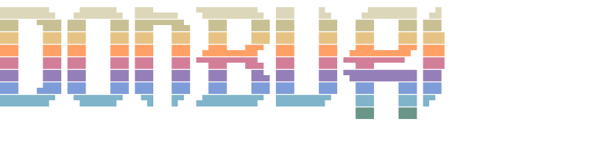
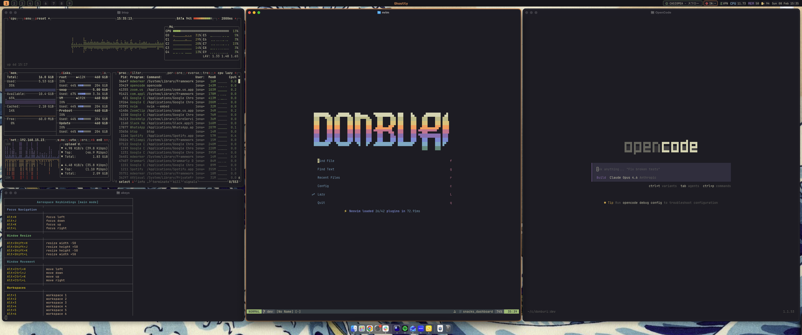

<p align="center">
  <br>
  
</p>
<p align="center">A unified macOS dotfiles configuration</p>

---

## Introduction

Donburi is a unified dotfiles repository for macOS that brings together terminal, multiplexer, editor, and shell configurations into a cohesive development environment. Rather than treating each tool as an island, donburi creates a seamless workflow where navigation feels natural across all applications.

The philosophy centers on three principles: **consistent hjkl-based navigation** across all tools, a **unified Kanagawa color scheme** for visual harmony, and a **herdr-centric workflow** where one terminal window holds every workspace, tab, and AI agent. Whether you're navigating Neovim splits or herdr panes, the muscle memory transfers.

Installation is **non-destructive**—existing configurations are automatically backed up before any changes are made. You can install everything at once or pick individual components to adopt incrementally.

<p align="center">
  
  <br>
  <sub>Screenshot taken on a 34" ultrawide monitor. This is my personal, opinionated configuration — your mileage may vary.</sub>
</p>

## Features

- **Unified hjkl-based navigation** across multiplexer, editor, and terminal
- **Non-destructive installation** with automatic backups of existing configs
- **Modular installation** — install all components or pick what you need
- **Consistent Kanagawa color scheme** across all applications
- **Workspace-centric workflow** via [herdr](https://herdr.dev), an agent-aware terminal multiplexer
- **Quick config aliases** for editing any configuration file

## Requirements

- **macOS 15+** (Sequoia)
- **Git** — for cloning the repository
- **Homebrew** — package manager for macOS (optional with `--no-brew` flag)

All other dependencies are installed automatically during setup (see below).

**Note for corporate users**: See [ENTERPRISE_SETUP.md](ENTERPRISE_SETUP.md) for installation in restricted environments.

## Quick Start

**One-liner installation:**

```bash
curl -fsSL https://raw.githubusercontent.com/jonataseduardo/donburi/main/install.sh | bash
```

This installs donburi to `~/.donburi` and adds the `donburi` command to your PATH.

**Or clone manually:**

```bash
git clone https://github.com/jonataseduardo/donburi.git ~/.donburi
~/.donburi/donburi setup
```

After installation:

```bash
donburi brew-check      # Check Homebrew status
donburi brew apps       # Install applications (nvim, ghostty, btop, etc.)
donburi setup           # Install all configurations
```

For environments without Homebrew:

```bash
donburi setup --no-brew # Setup configs without brew dependencies
```

## Components

| Component      | Description                               | Config Location                                              |
| -------------- | ----------------------------------------- | ------------------------------------------------------------ |
| **Neovim**     | Text editor with LSP, completions, AI     | `~/.config/nvim`                                             |
| **Ghostty**    | Modern GPU-accelerated terminal           | `~/Library/Application Support/com.mitchellh.ghostty/config` |
| **herdr**      | Agent-aware terminal multiplexer          | `~/.config/herdr`                                            |
| **zsh**        | Shell configuration with Oh My Zsh        | `~/.zshrc`                                                   |
| **btop**       | Resource monitor with Kanagawa theme      | `~/.config/btop`                                             |

### What Setup Installs Automatically

Each `donburi setup` component installs its own dependencies via Homebrew, git, and curl scripts:

| Component      | Auto-installed Dependencies                                                                                        |
| -------------- | ------------------------------------------------------------------------------------------------------------------ |
| **Neovim**     | ripgrep, gcc, make, [lazy.nvim](https://github.com/folke/lazy.nvim) plugin manager                                 |
| **Ghostty**    | JetBrains Mono Nerd Font                                                                                           |
| **herdr**      | herdr (via the official `curl` installer into `~/.local/bin`), jq (used by the `Ctrl+hjkl` navigation script) |
| **zsh**        | [Oh My Zsh](https://ohmyz.sh/), [Powerlevel10k](https://github.com/romkatv/powerlevel10k), fzf, lsd, gnu-sed, gawk |
| **btop**       | None (no external dependencies)                                                                                    |
| **Language Runtimes** | [Rust](https://www.rust-lang.org/) (via rustup), [uv](https://astral.sh/uv) (Python), [bun](https://bun.sh) (JavaScript) |

Neovim LSP servers and plugins auto-install on first launch via Mason and lazy.nvim.

### Custom Neovim Plugins

In addition to kickstart-modular.nvim's core plugins, donburi includes these custom plugins:

| Plugin | Purpose |
|--------|---------|
| **ChatGPT** | AI-powered code completion and generation |
| **dadbod** | Database UI and SQL query execution |
| **diffview** | Enhanced Git diff visualization |
| **fugitive** | Git integration and operations |
| **ghostty** | Ghostty terminal integration |
| **Kanagawa** | Unified color scheme with purple split dividers |
| **lualine** | Kanagawa vibrant statusline with flame separators |
| **markdown-preview** | Live Markdown preview |
| **python-debugger** | Python debugging support |
| **render-markdown** | Enhanced Markdown rendering |
| **smart-splits** | Seamless split navigation across Neovim and herdr panes |
| **toggleterm** | Integrated terminal multiplexer |

All plugins auto-install on first Neovim launch. View/manage with `:Lazy`.

### herdr Tab Bar

Donburi's herdr config ports the old tmux status bar to the right side of herdr's tab bar:

| Indicator | Purpose |
|-----------|---------|
| **Next Meeting** | Next/ongoing Google Calendar event with countdown (`herdr/scripts/next-meeting.sh`) |
| **Git branch** | Branch of the focused pane's directory (`herdr/scripts/git-branch.sh`) |
| **Directory** | Basename of the focused pane's directory |
| **Clock** | Current time |

Workspaces, their git status, and agent state (working / blocked / idle) live in herdr's sidebar (`prefix+b` toggles it). Colors use the Kanagawa palette with the `#FF9E64` surimiOrange accent. Customize in `~/.config/herdr/config.toml`.

The **Next Meeting** widget is **lazy / off by default** — it stays hidden and
makes no calendar calls until you enable tracking with `donburi meeting on`
(`donburi meeting off` hides it again). When enabled it reads Google Calendar
through `uvx gcalcli` (OAuth — no macOS Calendar permission needed). The first
`donburi meeting on` walks you through a one-time Google OAuth setup (you supply
your own Google Cloud "Desktop app" Client ID/Secret — set `GCALCLI_CLIENT_ID` /
`GCALCLI_CLIENT_SECRET` to skip the prompts). If it can't reach the calendar
(not authenticated, offline) the widget shows **`cal?`** instead of silently
looking idle.

**Terminal copy/paste:** herdr copies mouse selections to the clipboard
automatically, and `prefix+[` enters keyboard copy mode. Ghostty keyboard
copy/paste is `Ctrl+Shift+C` / `Ctrl+Shift+V`.

## CLI Commands

The `donburi` command provides several utilities for managing your configuration:

### Core Commands

```bash
donburi setup [component]     # Install configurations
donburi status                # Check symlink status
donburi permissions           # Check macOS permissions for apps
donburi meeting on            # Enable + show the lazy next-meeting widget
donburi meeting off           # Hide the next-meeting widget
donburi reload                # Reload the running herdr config
donburi update                # Update donburi via git pull
donburi --version             # Show donburi version
donburi help                  # Show help message
```

### Admin Commands (Enterprise)

For corporate environments with system-wide Homebrew installations:

```bash
donburi admin-setup           # Setup as administrator
donburi admin-check           # Check admin setup status
```

See [ENTERPRISE_SETUP.md](ENTERPRISE_SETUP.md) for detailed corporate installation instructions.

### Homebrew Management

```bash
donburi brew-check            # Check Homebrew installation status
donburi brew [category]       # Install packages via Homebrew
donburi brew --list           # Show available packages without installing
```

Package categories:
- `apps` — UI applications (neovim, ghostty, btop, jq)
- `cli` — Command-line tools (bat, fzf, ripgrep, gh, etc.)
- `utils` — Dev utilities, media & data processing, databases (node, python, ffmpeg, imagemagick, pandoc, yq, jless, fd, dust, httpie, watchexec, direnv, just, glow, tldr, zoxide, delta, choose-rust, sd, tokei, postgresql@18, sqlite, go, slack, spotify)
- `docker` — Container tools (colima, docker, docker-compose)
- `all` — Install everything

### Setup Options

```bash
donburi setup              # Install all components
donburi setup nvim         # Install a single component
donburi setup --dry-run    # Preview changes without applying
donburi setup --no-brew    # Setup without Homebrew dependencies
```

### Enterprise Usage

For corporate environments where users don't have admin privileges:

```bash
# Admin runs (single command, assumes Homebrew already installed):
su -l <admin> -c "curl -fsSL https://raw.githubusercontent.com/jonataseduardo/donburi/main/admin-install.sh | bash"

# Manual alternative (if not using admin-install.sh):
su -l <admin> -c "donburi brew all"      # Install all brew packages system-wide

# User runs:
donburi setup --no-brew    # Setup configs without brew dependencies
```

See [ENTERPRISE_SETUP.md](ENTERPRISE_SETUP.md) for detailed corporate setup instructions.

## Keybinding Reference

Donburi keeps the tmux keymap inside herdr (prefix `Ctrl+b`), so nothing changes for your fingers. Neovim and herdr share seamless `Ctrl+hjkl` navigation via [smart-splits.nvim](https://github.com/smart-splits-nvim/smart-splits.nvim) — pressing `Ctrl+h` moves between Neovim splits and herdr panes transparently.

| Action              | Neovim             | herdr                            |
| ------------------- | ------------------ | -------------------------------- |
| Focus / Navigate    | `Ctrl + hjkl`      | `Ctrl + hjkl`                    |
| Resize              | `Ctrl+W H/J/K/L`   | `prefix + hjkl`                  |
| Move / Swap         | `Ctrl+W Arrow`     | `prefix + Shift + hjkl`          |
| Split               | `Ctrl+W S/V`       | `prefix + "/%`                   |
| Zoom                | —                  | `prefix + z`                     |
| New / next / prev tab | —                | `prefix + c / n / p`             |
| Go to tab           | —                  | `prefix + 1-9`                   |
| Workspaces          | —                  | `prefix + w` (picker), `prefix + Shift + n` (new) |
| All herdr keys      | —                  | `prefix + ?`                     |

### Keybinding Helper Commands

Display color-coded keybinding tables for various applications:

```bash
nkeys               # Herdr & Neovim navigation keybindings
skeys               # Slack keybindings
ckeys               # Chrome/Chromium keybindings
gkeys               # Ghostty terminal keybindings
mkeys               # macOS system keybindings
```

Each command supports:

```bash
--no-pager          # Display without pager
--edit              # Edit the keybinding file
-h, --help          # Show command help
```

Example:

```bash
skeys --no-pager    # Show Slack keybindings without pager
gkeys --edit        # Open Ghostty keybindings for editing
```

## CLI Reference

```bash
donburi setup [component]     # Install configurations
donburi status                # Check symlink status
donburi brew [category]       # Install packages via Homebrew
donburi reload                # Reload herdr config
donburi update                # Update donburi (git pull)
donburi help                  # Show help
```

### Setup Options

```bash
donburi setup              # Install all components
donburi setup nvim         # Install a single component
donburi setup --dry-run    # Preview changes without applying
```

Available components: `nvim`, `ghostty`, `herdr`, `zsh`, `btop`, `keybinds`

### Brew Categories

```bash
donburi brew               # Install apps only (default)
donburi brew apps          # Install apps (nvim, ghostty, btop, jq)
donburi brew cli           # Install CLI tools (bat, lsd, fzf, ripgrep, htop, wget, bash, gcc, make, gnu-sed, gawk, curl, gh)
donburi brew utils         # Install dev, media & database tools (node, python, ffmpeg, imagemagick, pandoc, yq, jless, fd, dust, httpie, watchexec, direnv, just, glow, tldr, zoxide, delta, choose-rust, sd, tokei, postgresql@18, sqlite, go, slack, spotify)
donburi brew docker        # Install container tools (colima, docker, docker-compose, docker-buildx)
donburi brew all           # Install everything
donburi brew --list        # Show all packages without installing
donburi brew --dry-run     # Preview packages without installing
```

## Post-Installation

Verify the installation:

```bash
donburi status          # Check all symlinks (shows OK/WRONG/MISSING)
source ~/.zshrc         # Reload shell configuration
```

Test the setup:

1. Run `herdr` in Ghostty (or uncomment `command = ...herdr` in the Ghostty config to always start in it)
2. Split with `Ctrl+b %` / `Ctrl+b "` and open a new tab with `Ctrl+b c`
3. Open `nvim` and run `:checkhealth` to verify plugins
4. Press `Ctrl + hjkl` to navigate between Neovim splits and herdr panes

Navigation behaves exactly like the old tmux setup: inside Neovim (or fzf) the key
goes to the app, and smart-splits crosses into herdr at Neovim's edges. In a shell,
focus wraps around at the edges, and a lone pane ignores the key.

## Installing Code Formatters

Donburi automatically installs language runtimes (Rust, uv, bun) that allow you to install code formatters on demand. This gives you flexibility to install only the formatters you need.

### Available Formatters

| Formatter | Language | Install Command | Prerequisite |
|-----------|----------|-----------------|--------------|
| **shfmt** | Shell | `go install mvdan.cc/sh/v3/cmd/shfmt@latest` | `go` (installed via brew) |
| **ruff** | Python | `uv tool install ruff` or `pip install ruff` | `uv` or `python` (auto-installed) |
| **prettier** | JS/TS/JSON/YAML/MD | `npm install -g prettier` or `bun install -g prettier` | `node` or `bun` (auto-installed) |
| **taplo** | TOML | `cargo install taplo-cli` | `cargo` (auto-installed via Rust) |
| **markdownlint-cli** | Markdown | `npm install -g markdownlint-cli` | `node` (already in utils) |

### Installation Examples

**Install all formatters:**
```bash
# Go formatter
go install mvdan.cc/sh/v3/cmd/shfmt@latest

# Python formatter
uv tool install ruff

# JavaScript formatters
npm install -g prettier markdownlint-cli

# TOML formatter (requires Rust)
cargo install taplo-cli
```

**Or install individually as needed:**
```bash
# Just Python formatter
pip install ruff

# Just shell formatter
go install mvdan.cc/sh/v3/cmd/shfmt@latest

# Just Prettier (faster with bun)
bun install -g prettier
```

### Why Auto-Installed Language Runtimes?

- **Rust** (rustup) → Enables Rust tool ecosystem (taplo, etc.)
- **uv** → Fast Python package manager for ruff, other Python tools
- **bun** → Fast JavaScript runtime alternative to Node.js
- **node** (via brew) → JavaScript/TypeScript ecosystem, npm packages
- **python** (via brew) → Python development and pip packages
- **go** (via brew) → Shell formatting and other Go tools

You can skip installing formatters you don't use, keeping your system lean. All formatters are configured to auto-load in Neovim, but they're optional for core functionality.

## Environment Variables

Customize installation and behavior using these environment variables:

### Installation Variables

Set these when running `install.sh` or during manual setup:

| Variable | Description | Default |
|----------|-------------|---------|
| `DONBURI_HOME` | Custom installation directory | `~/.donburi` |
| `DONBURI_BRANCH` | Git branch to install from | `main` |
| `DONBURI_BREW_PATH` | Custom Homebrew installation path (enterprise) | Auto-detected |

Example:

```bash
# Install to custom location
DONBURI_HOME=~/MyApps/donburi bash install.sh

# Install from development branch
DONBURI_BRANCH=dev bash install.sh

# Set custom Homebrew path (enterprise environments)
DONBURI_BREW_PATH=/opt/homebrew donburi setup --no-brew
```

### Runtime Variables (`.env.example`)

Runtime secrets (currently the Google Calendar credentials for the next-meeting
widget) are documented in [`.env.example`](.env.example). `.env` and `.secrets`
are gitignored, so your real values never get committed.

Copy the template into `~/.secrets` (sourced automatically by `zsh/donburi.zsh`)
and fill in your values:

```bash
# Copy the template, then edit and fill in real values
cp .env.example ~/.secrets
${EDITOR:-vim} ~/.secrets

# Load it into the current shell (or just open a new terminal)
source ~/.secrets

# Enable the widget — it now authenticates without interactive prompts
donburi meeting on
```

Variables:

| Variable | Description |
|----------|-------------|
| `GCALCLI_CLIENT_ID` | Google Cloud OAuth (Desktop app) client ID for gcalcli |
| `GCALCLI_CLIENT_SECRET` | Matching OAuth client secret |

See `.env.example` for the one-time Google Cloud Console steps to create these.

## Config & Keybind Aliases

Quick shortcuts to edit configurations and view keybindings (added to your shell):

### Config Aliases

| Alias   | Opens             |
| ------- | ----------------- |
| `nconf` | Neovim config     |
| `gconf` | Ghostty config    |
| `hconf` | herdr config      |
| `zconf` | zsh config        |
| `dconf` | Donburi root (all configs) |

### Keybind Aliases

| Alias   | Shows                  |
| ------- | ---------------------- |
| `skeys` | Slack keybindings      |
| `ckeys` | Chrome keybindings     |
| `gkeys` | Ghostty keybindings    |
| `mkeys` | macOS keybindings      |
| `nkeys` | Herdr & Neovim navigation |

### Shell Aliases

Donburi includes `lsd` for a modern `ls` replacement:

| Alias | Command |
| ----- | ------- |
| `l`   | `lsd -l` (long format) |
| `la`  | `lsd -lA` (with hidden files) |
| `lla` | `lsd -llA` (long format, hidden files) |
| `tree` | `lsd --tree` (tree view) |

## Troubleshooting

**Ctrl+hjkl doesn't move between herdr panes**

- The keys run `~/.config/herdr/scripts/navigate.sh`; check `donburi status` shows the herdr link OK
- Requires `jq` on `PATH`
- Inside Neovim, `:lua print(require('smart-splits.mux').get().type)` should print `herdr`

**herdr config changes not applied**

```bash
donburi reload          # or: herdr server reload-config
herdr config check      # Validate config.toml
```

**macOS menu bar is hidden**

- The old SketchyBar setup hid the native menu bar. Restore it with:
  `defaults write NSGlobalDomain _HIHideMenuBar -bool false && killall SystemUIServer`

**Neovim plugins not loading**

- Run `:Lazy` inside Neovim to check plugin status
- Run `:checkhealth` for diagnostics

**Finding backed-up configs**

- Backups are stored in `~/.config/donburi-backup-<timestamp>/`

**donburi command not found**

- Restart your terminal or run: `export PATH="$HOME/.local/bin:$PATH"`

## Development

Donburi is actively maintained and welcomes contributions. Here are some useful resources:

### Project Files

| File | Purpose |
|------|---------|
| `VERSION` | Current version |
| `CHANGELOG.md` | Version history and changes |
| `AGENT.md` | Development guidelines for AI assistants |
| `.pre-commit-config.yaml` | Pre-commit hooks (shellcheck linting) |
| `test/test_donburi.sh` | Test suite for CLI commands |

### Development Workflow

Before submitting pull requests, run the linting checks:

```bash
prek run --all-files    # Run pre-commit hooks (shellcheck, etc.)
prek install            # Install git pre-commit hook
```

For detailed contribution guidelines, see [AGENT.md](AGENT.md).

### Resources

- **Upstream Neovim config**: [kickstart-modular.nvim](https://github.com/dam9000/kickstart-modular.nvim)
- **Issues & PRs**: [GitHub repository](https://github.com/jonataseduardo/donburi)

## License

MIT

## Acknowledgments

This project was built with significant assistance from [Claude Code](https://claude.ai/code), Anthropic's AI coding assistant.

- [kickstart-modular.nvim](https://github.com/dam9000/kickstart-modular.nvim) — Neovim configuration foundation
- [Kanagawa](https://github.com/rebelot/kanagawa.nvim) — color scheme
- [herdr](https://herdr.dev) — agent-aware terminal multiplexer
- [Ghostty](https://ghostty.org/) — terminal emulator
- [smart-splits.nvim](https://github.com/smart-splits-nvim/smart-splits.nvim) — seamless Neovim/multiplexer navigation
